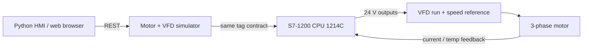

# PLC Motor Control with VFD

**Siemens S7-1200 · TIA Portal V19 · Ladder Logic · VFD · Python HMI**

Industrial motor control system for a 3-phase induction motor driven by a variable frequency drive. It implements start/stop, speed setpoint, acceleration and deceleration ramps, electrical and logical interlocks, overload protection, fault management and live monitoring of frequency and current.

> **Nota (ES):** Proyecto de demostración. La lógica se validó en simulador Python; el proyecto TIA se genera con Openness y la integración con un VFD real queda documentada, no verificada en hardware.

---

## 1. Industrial problem

A direct-on-line start produces high inrush current and mechanical stress. A VFD-based starter must ramp the motor to the requested speed, respect safety interlocks, trip on overload or drive fault, and give the operator a clear state and fault indication.

## 2. Objectives

- Start/stop a 3-phase motor through a VFD with local and remote command sources.
- Ramp frequency at configurable acceleration/deceleration rates.
- Enforce interlocks: emergency stop, overload relay, VFD ready, motor temperature.
- Latch and reset faults only when the fault condition has cleared.
- Monitor actual frequency, current and drive state from an HMI.
- Provide testable, documented code with a hardware-independent simulator.

## 3. System architecture



In hardware mode, the Python simulator is replaced by the S7-1200 program. The HMI tag contract (`DB20`) is identical in both cases. See [docs/architecture.md](docs/architecture.md).

## 4. Components

| Layer | Technology |
| --- | --- |
| PLC | Siemens S7-1200 CPU 1214C, TIA Portal V19 |
| Logic | Ladder-compatible FBs, distributed as SCL sources for Openness import |
| Simulation | Python 3.14 standard library |
| HMI | Static HTML/CSS/JS served by Python `http.server` |
| Diagrams | SVG power and control schematics |
| Tests | Python `unittest` |

## 5. Engineering documents

- [Architecture](docs/architecture.md)
- [Signal list and tag map](docs/signal-list.md)
- [Power and control diagrams](docs/electrical-diagram.md)
- [Control sequence](docs/control-sequence.md)
- [Test plan and results](docs/test-plan.md)
- [Ladder block documentation](plc/documentation/ladder-blocks.md)
- [TIA build procedure](plc/program/README.md)

## 6. PLC logic

| Block | Function |
| --- | --- |
| `FB_VFD_Ramp` | Acceleration/deceleration ramp, hold and setpoint tracking |
| `FB_MotorFaults` | Fault detection, latching, reset condition and fault code |
| `FB_MotorControl` | State machine, interlocks, start/stop, outputs |
| `OB1` | Cyclic call, I/O mapping, HMI telemetry |

## 7. Screenshots and diagrams

- [HMI mockup](screenshots/hmi.svg)
- [Power circuit](screenshots/power-circuit.svg)
- [Control circuit](screenshots/control-circuit.svg)

## 8. Installation and use

```powershell
cd "C:\Users\Bismarck Acevedo\Documents\Github\plc-motor-control-vfd"
python -m unittest discover -s simulation/tests -v
python simulation/motor_server.py
```

Open `http://127.0.0.1:4000`. Use Start, Stop, Reset and the setpoint slider. Fault buttons inject simulated overload, VFD fault and loss of cooling.

CLI-only demo:

```powershell
python simulation/motor_simulator.py --duration 40 --setpoint 35
```

## 9. API

| Method | Endpoint | Description |
| --- | --- | --- |
| `GET` | `/api/state` | Current motor/VFD state and DB20 tags |
| `POST` | `/api/command` | `{"command":"START"|"STOP"|"RESET"}` |
| `POST` | `/api/setpoint` | `{"setpoint_hz": 35}` |
| `POST` | `/api/fault` | `{"fault":"overload"|"vfd_fault"|"cooling","active":true}` |

## 10. Tests

```powershell
python -m unittest discover -s simulation/tests -v
```

Covers 4-20 mA scaling, ramp math, start permissive, overload trip, fault reset rules, deceleration, current model, HMI tag contract and REST endpoints. Results: see [docs/test-plan.md](docs/test-plan.md).

## 11. Evidence matrix

| Item | Status | Evidence |
| --- | --- | --- |
| Motor/VFD model and state machine | Simulated and unit tested | `simulation/tests` |
| Ladder block design | Documented, generated as SCL | `plc/` |
| TIA project execution | Not run here | Requires TIA V19 Openness license |
| VFD communication | Not verified | No drive connected |
| Electrical diagrams | Designed as SVG | `screenshots/` |
| HMI values | Synthetic simulation data | `simulation/motor_simulator.py` |

## 12. Limitations and future work

- No physical motor, VFD or overload relay was connected.
- Profinet/Modbus drive control is future work; current design uses digital run + analog reference.
- Add brake logic, jog mode and PID process control before a real deployment.
- Verify electrical interlocks and safety categories with a qualified electrician.

## 13. Quality checklist

- [x] Industrial problem clearly defined
- [x] Architecture and technical diagrams
- [x] Organized source code
- [x] Functional control simulation
- [x] User interface
- [x] Documented tests
- [x] Electrical schematics
- [x] Complete README (technical English + Spanish notes)
- [x] Repository initialized on `main`

---

**Author:** Bismarck Acevedo — Electronic Engineer, Industrial Automation & PLC Programming.
