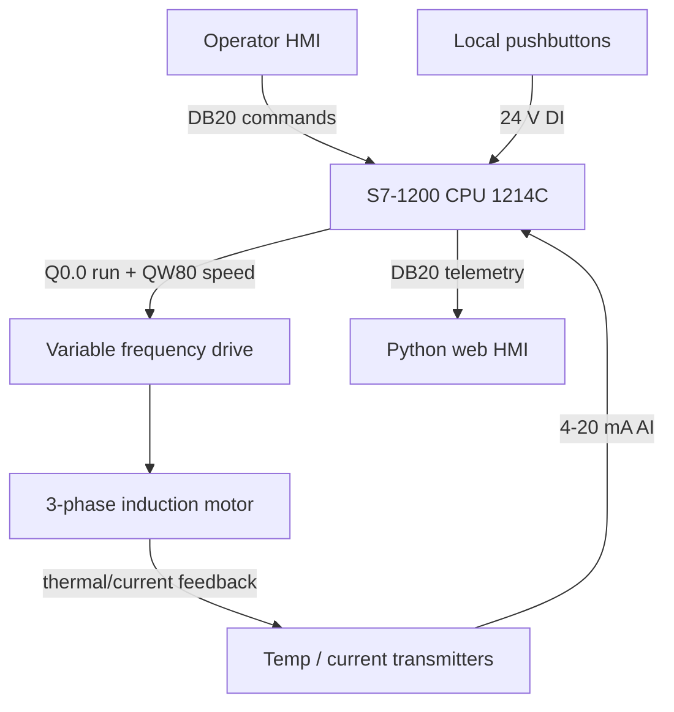

# Architecture

## 1. Overview

## 2. Control layers

| Layer | Responsibility |
| --- | --- |
| Field devices | E-stop, overload relay, VFD ready, motor thermistor, current transmitter |
| PLC | Interlocks, state machine, ramps, fault latching, HMI mapping |
| VFD | Power conversion and motor current regulation |
| HMI | Command entry and visualization |

## 3. Software blocks

`OB1` calls `FB_MotorFaults`, then `FB_VFD_Ramp`, then `FB_MotorControl` and maps physical I/O to `DB20`. The Python simulator implements the same call order and tag names.

## 4. Operating modes

- **Local**: physical Start/Stop pushbuttons and speed potentiometer.
- **Remote**: HMI start/stop/reset and numeric speed setpoint.

Mode changes do not stop a running motor; the active command source changes at the next edge.

## 5. Timing

| Item | Value |
| --- | --- |
| PLC scan / simulator tick | 100 ms (simulator default 1 s) |
| Acceleration | 5 Hz/s configurable |
| Deceleration | 7 Hz/s configurable |
| Overcurrent trip delay | 2 s above 150 % rated current |
| Reset | Rising edge, only when all fault conditions are clear |

## 6. Nota (ES)

El simulador y el PLC comparten `DB20`; por eso la HMI y las pruebas no cambian al migrar a hardware real.
