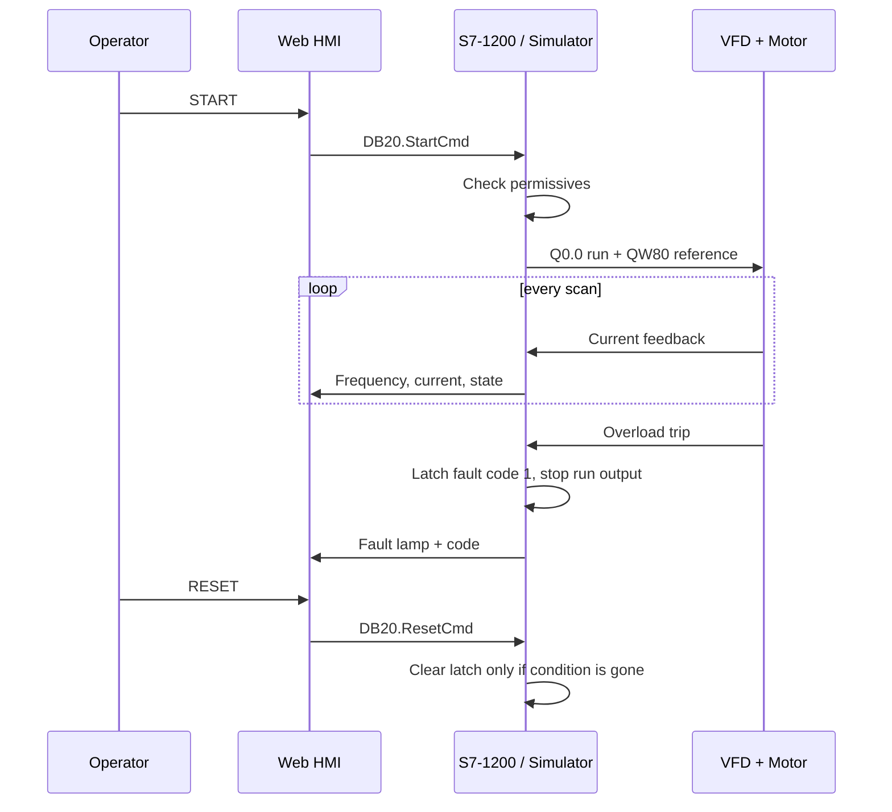

# Control sequence

## 1. State machine

| State | Entry condition | Outputs |
| --- | --- | --- |
| `STOPPED` (0) | No start command | Run output off, frequency 0 Hz |
| `STARTING` (1) | Start accepted, interlocks healthy | Run output on, ramp up to setpoint |
| `RUNNING` (2) | Frequency within 0.5 Hz of setpoint | Run output on, monitor current |
| `STOPPING` (3) | Stop command or healthy stop request | Ramp down to 0 Hz, then STOPPED |
| `FAULTED` (4) | Any latched fault | Run output off, fault lamp/horn on |

## 2. Start permissives

A start is accepted only if:

1. E-stop is healthy.
2. Overload relay is healthy.
3. VFD ready is true.
4. Motor temperature is healthy.
5. No fault is latched.
6. Setpoint is greater than 0 Hz.

## 3. Ramps

- `ActualFrequency` moves toward `SpeedSetpoint_Hz` at `AccelRate_Hz_s`.
- On stop it moves toward 0 Hz at `DecelRate_Hz_s`.
- Ramping is blocked in `FAULTED`; frequency drops to 0 immediately.

## 4. Faults

| Code | Fault | Detection | Reset condition |
| --- | --- | --- | --- |
| 1 | Overload | `I0.1 = 0` | Overload healthy and ResetCmd edge |
| 2 | VFD fault | `I0.2 = 0` while run requested | VFD ready and ResetCmd edge |
| 3 | Overcurrent | Current > 150 % rated for 2 s | Current normal and ResetCmd edge |
| 4 | Cooling | `I0.3 = 0` | Temperature OK and ResetCmd edge |
| 5 | E-stop | `I0.0 = 0` | E-stop healthy and ResetCmd edge |

Fault priority: E-stop > overload > cooling > VFD > overcurrent. Only the highest-priority active fault is displayed, but all latched faults must clear before restart.

## 5. Sequence diagram

## 6. Nota (ES)

El arranque nunca omite interbloqueos: un Start con E-stop activo se ignora y no incrementa el contador de arranques.
